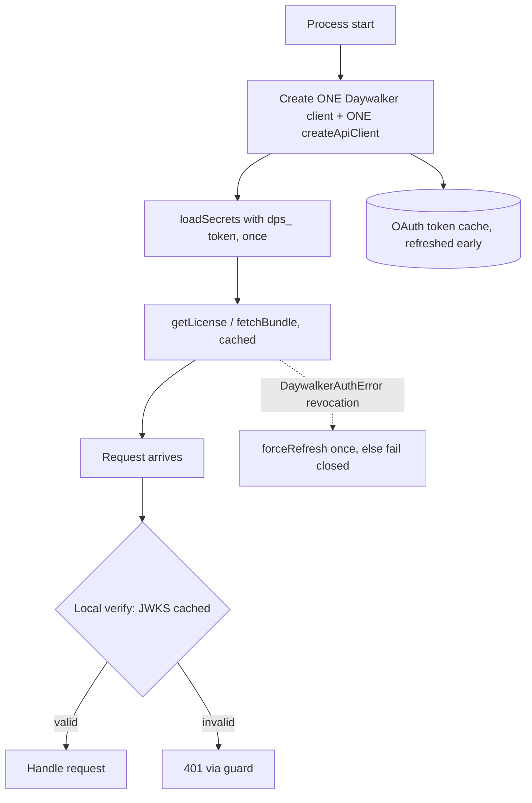

# Migrating `@shelbyb/daywalker-sdk` from 0.10.0 to 0.17.0

## TL;DR

- **The upgrade is additive. No breaking change was found.** Verified by diffing `v0.10.0..HEAD`: every 0.10 export is still exported, and the only change in `src/client.ts` is that bundle decryption moved into a shared `unsealBundle()` helper with identical behavior. No `0.11`–`0.17` changelog entry is marked breaking.
- Bump the version, run your build and tests, and you are done. Everything below 0.17 is opt-in.
- The only things that may need action: Node `>=20.19`, ESM only, and (new in 0.15) the package is `UNLICENSED`, so run `daywalker license check` in CI if you ship under the DevPulse license.
- Note on the 0.17 helpers: they are exported from the **root** entry (`@shelbyb/daywalker-sdk`), not from `/api`. The changelog's "see `/api`" refers only to the OAuth management client.

```sh
npm install @shelbyb/daywalker-sdk@0.17.0
npm run build && npm test
```

## Compatibility

| Item | 0.10.0 | 0.17.0 | Action |
|---|---|---|---|
| Node | `>=20.19` | `>=20.19` | none |
| Module format | ESM only | ESM only | none (no `require`) |
| Runtime dependency | `re2js` | `re2js` | none |
| Optional peers | `@openfeature/*`, `react` | same | install only if you import those subpaths |
| Root exports (`Daywalker`, `DaywalkerAuthError`, ...) | present | all still present | none |
| New subpaths | | `/api`, `/webhooks`, `/cron`, `/logs`, `/secrets`, `/secrets/env`, `/oncall`, `/slo`, `/deploys`, `./package.json` | opt in |
| Package `license` | none | `UNLICENSED` | see 0.15 / 0.16 |

## Step-by-step upgrade

1. `npm install @shelbyb/daywalker-sdk@0.17.0` (and commit the lockfile).
2. Confirm Node `>=20.19` locally, in CI and in your Docker image.
3. Keep `"type": "module"` / ESM imports. Do not `require()` the package.
4. Only if you use them, keep `@openfeature/server-sdk` (`^1.17.0`), `@openfeature/web-sdk` (`^1.5.0`) or `react` (`>=18`) installed. They are optional peers.
5. Run `npm run build` and your tests. Expect no code changes.
6. If your repo ships under the DevPulse license: `npx -p @shelbyb/daywalker-sdk daywalker license check` in CI (see 0.15/0.16).
7. Adopt the recommended patterns below, one at a time.

## Per-version notes

| Version | What changed | Impact |
|---|---|---|
| 0.11.0 | Web Vitals capture in `/analytics` (privacy opt-out respected). | Opt-in. Existing behavior unchanged. |
| 0.12.0 | `/api` OAuth2 management client (`createApiClient`, `ApiProblemError`, pagination, retry/RateLimit handling). Portable runtimes (no Node built-ins in the auth path). `./package.json` export. | Opt-in. See `docs/api-client.md`, `docs/runtimes.md` (in the repo). |
| 0.13.0 | Clients for `/webhooks`, `/cron`, `/logs`, `/secrets`, `/oncall`, `/slo`, `/deploys`. HTTPS-only, size caps. | Opt-in. Existing behavior unchanged. |
| 0.14.0 | Runnable Python, Go and Ruby signed-token validation examples (`examples/`). | Docs only. |
| 0.15.0 | Package license `UNLICENSED`, CLA. | Review terms; no code impact. |
| 0.16.0–0.16.2 | `daywalker license apply\|check`, `--exclude`. 0.16.2: a package that already declares a `license` is not relicensed (use `--replace-existing`), `package.json` formatting is preserved. | CI/tooling only. |
| 0.17.0 | `verifyAccessToken`, `accessTokenServices`, `accessTokenServiceLimits`, `unsealBundle`, `DaywalkerManagementClient` / `createManagementClient`, `generateDpopKey`, `createDpopProof`. | Opt-in, root export. |

### 0.17 helper reference (from `dist/management.d.ts`)

- `verifyAccessToken({ token, serviceSlug, jwks, issuer?, currentTime? })` returns `{ valid: true, claims, services, serviceLimits }` or `{ valid: false, error }`. EdDSA only, `typ: at+jwt`, `aud` must contain `serviceSlug`, `exp`/`nbf` checked. DPoP-bound tokens (`cnf.jkt`) still need `verifyDpopProof`.
- `unsealBundle(licenseKey, sealed, serviceSlug?)` decrypts an `{ iv, tag, ciphertext }` bundle. `Daywalker.fetchBundle()` already uses it internally.
- `createManagementClient({ authUrl, sessionToken, fetch?, timeoutMs? })` manages API tokens with a user **session JWT** (not an API key). Errors are `DaywalkerManagementError`.

## Recommended architecture



### 1. One client per process

Create clients at module scope so the token, license and key caches are shared. Do not create a client per request.

```ts
import { Daywalker } from "@shelbyb/daywalker-sdk";
import { createApiClient } from "@shelbyb/daywalker-sdk/api";

export const daywalker = new Daywalker({ serviceSlug: process.env.DAYWALKER_SERVICE_SLUG, jwks: "auto" });

export const api = createApiClient({
  host: process.env.DEVPULSE_URL!,
  clientId: process.env.DEVPULSE_CLIENT_ID!,
  clientSecret: process.env.DEVPULSE_CLIENT_SECRET!,
});
```

`jwks: "auto"` verifies access tokens offline against `${authUrl}/.well-known/jwks.json` (cached), so key rotation needs no redeploy.

### 2. Never hand-roll token fetches

`ApiClient.getAccessToken()` uses the client credentials grant, caches the token and refreshes it `refreshSkewSeconds` (default 60) before expiry. Call `api.get/post/patch(...)` or `paginate(...)` and let it manage the token. Use `api.clearToken()` only after revoking a credential.

### 3. License and bundle: rely on the cache

```ts
import { DaywalkerAuthError } from "@shelbyb/daywalker-sdk";
import { daywalker } from "./clients.js";

export async function boot() {
  try {
    const license = await daywalker.getLicense();
    const bundle = await daywalker.fetchBundle();
    return { license, bundle };
  } catch (err) {
    if (err instanceof DaywalkerAuthError) {
      console.error("daywalker auth failure", err.code);
      process.exit(1);
    }
    throw err;
  }
}
```

Avoid `forceRefresh` in normal paths. Use it only after a revocation-class error.

### 4. Validate tokens locally at the edge of your app

Use the guards instead of calling the service per request.

```ts
// Next.js route handler
import { withDaywalkerAuth } from "@shelbyb/daywalker-sdk/next";
export const POST = withDaywalkerAuth(async (_req, { auth }) => Response.json({ svc: auth.serviceSlug }));
```

```ts
// Express / Connect
import { daywalkerAuth } from "@shelbyb/daywalker-sdk/express";
app.use("/api", daywalkerAuth({ serviceSlug: process.env.DAYWALKER_SERVICE_SLUG }));
```

Fetch-style runtimes can use `daywalkerAuth` from `@shelbyb/daywalker-sdk/middleware`. For custom verification:

```ts
import { verifyAccessToken } from "@shelbyb/daywalker-sdk";
import { daywalker } from "./clients.js";

export async function check(token: string) {
  const jwks = await daywalker.fetchJwks(); // cached
  const r = await verifyAccessToken({ token, serviceSlug: "my-service", jwks });
  return r.valid ? r.services : null;
}
```

### 5. Webhooks and secrets

```ts
import { verifyWebhook, WebhookVerificationError } from "@shelbyb/daywalker-sdk/webhooks";

export async function POST(req: Request) {
  const body = await req.text(); // raw body, verify before parsing
  try {
    await verifyWebhook({ secret: process.env.DEVPULSE_WEBHOOK_SECRET!, headers: req.headers, body });
    return new Response(null, { status: 204 });
  } catch (err) {
    if (err instanceof WebhookVerificationError) return new Response(err.code, { status: 400 });
    throw err;
  }
}
```

```ts
import { loadSecrets } from "@shelbyb/daywalker-sdk/secrets/env";
await loadSecrets({ host: process.env.DEVPULSE_URL!, token: process.env.DEVPULSE_SECRETS_TOKEN! }); // dps_ token
```

## Error handling

| Error | Meaning | Do |
|---|---|---|
| `DaywalkerAuthError` `SERVICE_REVOKED` | Service credential revoked | Fail closed, alert, do not retry |
| `SERVICE_SUSPENDED` | Service suspended | Fail closed, alert; retry later |
| `DOMAIN_REVOKED` / `DOMAIN_MISMATCH` | Domain not allowed | Fix config; do not retry |
| `LICENSE_UNAVAILABLE` | License could not be obtained | Retry with backoff; see `UNAVAILABLE_ERROR_CODES` |
| `BUNDLE_UNREADABLE` | Sealed bundle failed to decrypt | Check the license key; one `forceRefresh`, then fail |
| `DaywalkerRateLimitError` | 429 | Wait `retryAfter` seconds |
| `ApiProblemError` | RFC 9457 problem from `/api/v1` (`isPreconditionFailed`, ...) | Branch on the flags; re-read and retry on 412 |
| `WebhookVerificationError` | Bad signature or timestamp | Respond 400 |

## Anti-patterns

- Creating a `Daywalker` or API client per request (defeats every cache).
- Hand-rolled `POST /api/v1/oauth/token` calls.
- Calling `validateToken` on the service for every request when local verification is available.
- Using `forceRefresh` on a schedule.
- Putting credentials in URLs, logs, error messages or client bundles. Clients redact in `toJSON()`; don't bypass it.
- Parsing a webhook body before verifying the signature.
- Using a session-JWT `createManagementClient` with an API key.

## Verification checklist

- [ ] `npm ls @shelbyb/daywalker-sdk` shows 0.17.0
- [ ] Node `>=20.19` everywhere
- [ ] `npm run build` and tests pass
- [ ] `daywalker license check` passes in CI (if applicable)
- [ ] Exactly one client instance per process
- [ ] Revocation errors fail closed and alert
- [ ] No credentials in logs or bundles

## Rollback

Pin `@shelbyb/daywalker-sdk@0.10.0` and reinstall. Because 0.17 is additive, code written for 0.10 runs unchanged. Remove only the new subpath imports you adopted. If `daywalker license apply` ran, the `LICENSE`, header comments and `package.json` `license` field remain and must be reverted from version control.

## Prompt for AI agents

> Upgrade `@shelbyb/daywalker-sdk` from 0.10.0 to 0.17.0 in this repo. The release is additive with no breaking changes. Bump the dependency, verify Node >=20.19 and ESM, run build and tests. Then ensure: one `Daywalker` client and one `createApiClient` instance per process; no hand-written OAuth token fetches; `getLicense`/`fetchBundle` used with default caching and `DaywalkerAuthError` codes handled; incoming tokens verified locally via `@shelbyb/daywalker-sdk/next`, `/express` or `/middleware` guards (`jwks: "auto"`); webhooks verified with `verifyWebhook` on the raw body; secrets via `loadSecrets` with a `dps_` token; no credentials in URLs, logs or client code. Do not change behavior beyond this.
